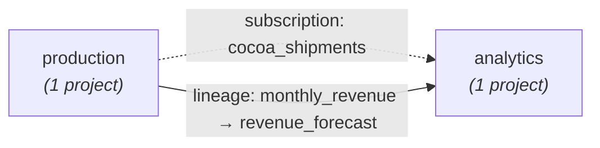

# cross-domain-lineage

Reads **AWS DataZone subscriptions** and **OpenLineage events** posted to a
DataZone domain and produces a **domain-unit-to-domain-unit dependency graph**
as Mermaid markdown and a self-contained interactive HTML page.

The output is a single picture of who depends on whom across bounded contexts
in the mesh -- exactly what a federated governance review needs to see before
approving a new subscription, deprecating an asset, or moving a project.

## Sample lineage graph

Rendered live from the `chocolate-mesh` demo domain after running
`./scripts/seed.sh` (see [Demo seed](#demo-seed) below):



| Kind | Producer unit | Consumer unit | Label | Detail |
|---|---|---|---|---|
| subscription (dashed) | production | analytics | `cocoa_shipments` | status=ACCEPTED, listing=cgtohix5 |
| lineage (solid) | production | analytics | `monthly_revenue → revenue_forecast` | job=forecast_revenue |

Reading the picture:

- The **dashed** arrow is intent: `chocolate-consumer` (analytics) filed an
  accepted subscription request against `chocolate-producer`'s
  `cocoa_shipments` listing.
- The **solid** arrow is fact: an OpenLineage `JobRun` event was posted whose
  input asset (`monthly_revenue`, owned by production) and output asset
  (`revenue_forecast`, owned by analytics) belong to different domain units.
- Both arrows point the same way -- production produces, analytics consumes --
  which is the shape you want. A solid arrow with no matching dashed arrow
  would mean lineage is moving data without an approved subscription, and
  that's exactly the kind of thing this graph is meant to surface.

## Why this exists

DataZone surfaces lineage and subscriptions per-asset and per-listing, but
nothing in the console shows you the **cross-domain shape** of your mesh:

- Which producing units have the most consumers?
- Which units are sinks (consume only) vs sources (produce only)?
- Are there hidden cycles between domain units?

Those questions are governance questions, not asset questions. This tool
answers them in one read-only pass.

## What gets drawn

Nodes are **domain units** -- the bounded contexts that own one or more
projects. Edges come from two sources:

| Edge kind | Source | Arrow style |
|---|---|---|
| `subscription` | Approved/pending DataZone subscription requests where the consumer project's owning unit ≠ the listing's owning unit | dashed (`-.->`) |
| `lineage` | OpenLineage `JobRun` events posted via `PostLineageEvent` whose input/output assets resolve to different domain units | solid (`-->`) |

Edges within the same unit are dropped (they're intra-domain plumbing, not
governance signals).

## Project layout

```
cross-domain-lineage/
├── src/xdl/
│   ├── __main__.py
│   └── cli.py             # collect signals, score, render Mermaid + HTML + JSON
├── scripts/
│   ├── lineage.sh         # run the graph build
│   └── seed.sh            # seed demo Glue tables, asset, listing, subscription, OL events
├── out/                   # generated reports (Markdown / HTML / JSON)
├── requirements.txt
└── README.md
```

## Prerequisites

- AWS profile with at least `datazone:Get*`, `datazone:List*`, `datazone:Search*`,
  and (only for the seed step) `datazone:Create*`, `datazone:PostLineageEvent`,
  `glue:Create*`, `glue:Get*`
- Python 3.10+
- A DataZone domain in `AVAILABLE` status

## Quick start

```bash
cd cross-domain-lineage
python3 -m venv .venv && source .venv/bin/activate
pip install -r requirements.txt

# Auto-pick the only domain in the region:
./scripts/lineage.sh default

# Or name the domain explicitly:
./scripts/lineage.sh default chocolate-mesh
```

Outputs land in `out/`:

```
out/<domain-name>-lineage.md     # Markdown with embedded Mermaid block
out/<domain-name>-lineage.html   # interactive page (Mermaid via CDN + edges table)
out/<domain-name>-lineage.json   # raw graph (units, projects, edges) for piping
```

## Demo seed

If you applied `datazone-as-code/manifests/example.yaml` (the chocolate-mesh
demo) the domain has the right shape but no assets, listings, subscriptions,
or lineage events. Run the seed once to populate them:

```bash
./scripts/seed.sh default chocolate-mesh
```

The seed creates:

| Resource | Where |
|---|---|
| Glue database `xdl_demo` + tables `cocoa_shipments`, `monthly_revenue`, `revenue_forecast` | Glue Data Catalog |
| DataZone GlueTable assets for each table | `chocolate-producer` (production unit) for the first two; `chocolate-consumer` (analytics unit) for `revenue_forecast` |
| Listing for `cocoa_shipments` | published from producer |
| Subscription request | `chocolate-consumer` -> the `cocoa_shipments` listing |
| OpenLineage events | `cocoa_shipments` -> `monthly_revenue` (intra-domain), `monthly_revenue` -> `revenue_forecast` (cross-domain) |

After seeding, `./scripts/lineage.sh default chocolate-mesh` produces the
two-edge graph below.

## Example output (live test)

```
== cross-domain-lineage: domain dzd-dcoigj8fhoucuo (region=us-west-2) ==
  collected: units=3 projects=2 edges=2
== wrote out/chocolate-mesh-lineage.md / .html / .json ==
```


The dashed arrow is the subscription `chocolate-consumer` filed against the
producer's listing. The solid arrow is the OpenLineage event whose input
(`monthly_revenue`, owned by production) and output (`revenue_forecast`,
owned by analytics) cross the unit boundary.

## Read-only by default

The `lineage` subcommand only calls `Get*`, `List*`, and `Search*` on
DataZone -- safe to run against production. The `seed` subcommand (`Create*`
and `PostLineageEvent`) is opt-in and only meant for the chocolate-mesh demo
domain.

## Design decisions

- **Nodes are domain units, not projects**: a "data mesh" review is about
  bounded contexts, not personal sandboxes. Multiple producer projects under
  one unit collapse to a single node.
- **Same-unit edges are dropped**: they're internal plumbing. Federated
  governance only cares about edges that cross unit boundaries.
- **Two edge kinds, two arrow styles**: subscriptions show *intent* (someone
  asked for access); lineage shows *fact* (the data actually moved). They're
  drawn with different arrows so reviewers can spot listings that nobody
  actually consumes -- or lineage that's running without a subscription.
- **Mermaid + HTML, no static PNG**: HTML is rendered client-side with
  Mermaid's CDN bundle. The Markdown file is the same graph for embedding
  in PRs, runbooks, or wiki pages.
- **`ListLineageEvents` is the authoritative source**: the response items
  already carry the parsed OpenLineage summary in `eventSummary
  .openLineageRunEventSummary` -- no need to fetch the full event blob.
- **Subscription requests are filtered per-project**: the API requires either
  `owningProjectId` or `approverProjectId`; we fan out across both directions
  for every project so cross-project subscriptions are captured regardless of
  which side filed the request.
