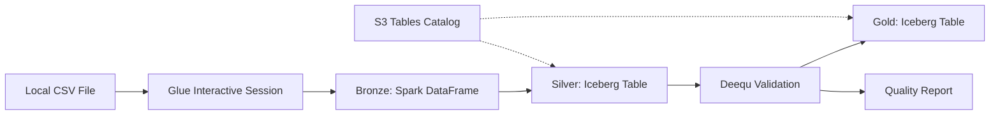

# Design Document: Chicago Violations Data Pipeline

## Overview

This design specifies a JupyterLab notebook that implements a medallion architecture data pipeline for Chicago ordinance violations data. The pipeline uses AWS Glue interactive sessions to provide managed Spark compute, processes data through three stages (bronze → silver → gold), and leverages S3 Tables with Apache Iceberg for lakehouse storage with ACID guarantees.

The pipeline architecture follows these principles:
- **Separation of concerns**: Each stage has a distinct purpose (ingestion, transformation, validation)
- **Incremental processing**: Data flows through stages with clear checkpoints
- **Data quality first**: Deequ validation ensures only quality data reaches gold stage
- **Cloud-native**: Leverages AWS managed services (Glue, S3 Tables) for scalability

## Architecture

### High-Level Flow

```
Source CSV → Bronze (Raw) → Silver (Iceberg) → Gold (Validated Iceberg)
              ↓                ↓                  ↓
           Local File      S3 Tables          S3 Tables
                          (Partitioned)      (Quality Checked)
```

### Component Architecture



### Technology Stack

- **Compute**: AWS Glue Interactive Sessions (Spark 3.x)
- **Storage**: S3 Tables with Apache Iceberg
- **Catalog**: AWS Glue Data Catalog
- **Quality**: Amazon Deequ
- **Interface**: JupyterLab with Glue magic commands
- **Language**: Python 3 with PySpark

## Components and Interfaces

### 1. Notebook Configuration Cell

**Purpose**: Initialize Glue interactive session with required dependencies

**Configuration Parameters**:
```python
{
    "glue_version": "4.0",
    "kernel": "python3",
    "worker_type": "G.1X",
    "number_of_workers": 2,
    "extra_jars": [
        "deequ-2.0.x.jar",
        "iceberg-spark-runtime-3.x.jar"
    ],
    "catalog_impl": "org.apache.iceberg.aws.glue.GlueCatalog",
    "s3_tables_bucket_arn": "arn:aws:s3tables:region:account:bucket/bucket-name"
}
```

**Magic Commands**:
- `%glue_version`: Set Glue version
- `%extra_jars`: Add Deequ and Iceberg dependencies
- `%idle_timeout`: Set session timeout
- `%%configure`: Configure Spark session properties

### 2. Bronze Stage Component

**Purpose**: Load raw CSV data into Spark DataFrame

**Input**: 
- File path: `.kiro/data/chicago-ordinance-violations-sample.csv`
- Format: CSV with header row

**Output**: 
- Spark DataFrame with inferred schema
- All original columns preserved

**Key Operations**:
```python
df_bronze = spark.read \
    .option("header", "true") \
    .option("inferSchema", "true") \
    .option("escape", '"') \
    .csv(source_path)
```

**Schema Inference**: Spark automatically detects column types from CSV data

### 3. Silver Stage Component

**Purpose**: Transform bronze data into partitioned Iceberg table

**Input**: Bronze Spark DataFrame

**Output**: Iceberg table in S3 Tables

**Transformations**:
1. **Type Casting**:
   - Date columns → TimestampType
   - Numeric columns → DoubleType/IntegerType
   - String columns → StringType

2. **Column Normalization**:
   - Replace spaces with underscores in column names
   - Convert to lowercase for consistency

3. **Partitioning Strategy**:
   - Partition by `ward` column (integer)
   - Enables efficient filtering by ward

**Iceberg Table Configuration**:
```python
{
    "format-version": "2",
    "write.parquet.compression-codec": "snappy",
    "write.metadata.compression-codec": "gzip",
    "write.distribution-mode": "hash",
    "catalog-impl": "org.apache.iceberg.aws.glue.GlueCatalog"
}
```

**Write Operation**:
```python
df_silver.writeTo("chicago_lakehouse.violations_silver") \
    .using("iceberg") \
    .partitionedBy("ward") \
    .tableProperty("format-version", "2") \
    .createOrReplace()
```

### 4. Deequ Validation Component

**Purpose**: Validate data quality using constraint checks

**Input**: Silver Iceberg table as DataFrame

**Output**: 
- Validation result (success/failure)
- Detailed constraint check report

**Validation Checks**:

1. **Completeness Checks**:
   - `id`: 100% complete
   - `docket_number`: 100% complete
   - `address`: 100% complete
   - `violation_date`: 100% complete

2. **Uniqueness Check**:
   - `id`: Must be unique across all records

3. **Range Checks**:
   - `imposed_fine`: >= 0
   - `admin_costs`: >= 0
   - `latitude`: Between -90 and 90
   - `longitude`: Between -180 and 180

4. **Type Checks**:
   - Numeric columns are valid numbers
   - Date columns are valid timestamps

**Deequ Implementation**:
```python
from pydeequ.checks import Check, CheckLevel
from pydeequ.verification import VerificationSuite

check = Check(spark, CheckLevel.Error, "Data Quality Checks") \
    .isComplete("id") \
    .isComplete("docket_number") \
    .isComplete("address") \
    .isComplete("violation_date") \
    .isUnique("id") \
    .isNonNegative("imposed_fine") \
    .isNonNegative("admin_costs") \
    .isContainedIn("latitude", -90, 90) \
    .isContainedIn("longitude", -180, 180)

result = VerificationSuite(spark) \
    .onData(df_silver) \
    .addCheck(check) \
    .run()
```

### 5. Gold Stage Component

**Purpose**: Write validated data to production Iceberg table

**Input**: Silver DataFrame (after validation passes)

**Output**: Gold Iceberg table in S3 Tables

**Conditional Logic**:
- If validation passes → Write to gold table
- If validation fails → Generate error report, halt pipeline

**Write Operation**:
```python
if validation_passed:
    df_silver.writeTo("chicago_lakehouse.violations_gold") \
        .using("iceberg") \
        .partitionedBy("ward") \
        .tableProperty("format-version", "2") \
        .createOrReplace()
```

### 6. Reporting Component

**Purpose**: Display pipeline execution metrics and results

**Outputs**:
- Row counts per stage
- Execution time per stage
- Sample records from each stage
- Deequ validation report
- Iceberg table metadata (snapshots, partitions)

## Data Models

### Source Schema (CSV)

```
ID: string
DOCKET NUMBER: string
NOV NUMBER: string
ADDRESS: string
STREET NUMBER: string
STREET DIRECTION: string
STREET NAME: string
STREET TYPE: string
WARD: string
ISSUING DEPARTMENT: string
HEARING DATE: string
CASE DISPOSITION: string
IMPOSED FINE: string
ADMIN COSTS: string
LAST MODIFIED DATE: string
VIOLATION DATE: string
VIOLATION CODE: string
VIOLATION DESCRIPTION: string
RESPONDENTS: string
LATITUDE: string
LONGITUDE: string
LOCATION: string
```

### Silver/Gold Schema (Iceberg)

```python
StructType([
    StructField("id", StringType(), False),
    StructField("docket_number", StringType(), False),
    StructField("nov_number", StringType(), True),
    StructField("address", StringType(), False),
    StructField("street_number", IntegerType(), True),
    StructField("street_direction", StringType(), True),
    StructField("street_name", StringType(), True),
    StructField("street_type", StringType(), True),
    StructField("ward", IntegerType(), True),
    StructField("issuing_department", StringType(), True),
    StructField("hearing_date", TimestampType(), True),
    StructField("case_disposition", StringType(), True),
    StructField("imposed_fine", DoubleType(), True),
    StructField("admin_costs", DoubleType(), True),
    StructField("last_modified_date", TimestampType(), True),
    StructField("violation_date", TimestampType(), False),
    StructField("violation_code", StringType(), True),
    StructField("violation_description", StringType(), True),
    StructField("respondents", StringType(), True),
    StructField("latitude", DoubleType(), True),
    StructField("longitude", DoubleType(), True),
    StructField("location", StringType(), True)
])
```

**Partitioning**: By `ward` (IntegerType)

### Iceberg Table Metadata

Each Iceberg table maintains:
- **Snapshots**: Point-in-time versions of the table
- **Manifests**: Lists of data files
- **Schema evolution history**: Track schema changes over time
- **Partition specs**: Partitioning configuration


## Correctness Properties

A property is a characteristic or behavior that should hold true across all valid executions of a system—essentially, a formal statement about what the system should do. Properties serve as the bridge between human-readable specifications and machine-verifiable correctness guarantees.

### Property 1: Data Preservation Through Pipeline

*For any* input DataFrame from the bronze stage, the number of rows written to the silver Iceberg table should equal the number of rows in the input DataFrame (no records lost or deduplicated).

**Validates: Requirements 2.4, 3.5**

### Property 2: Column Preservation

*For any* input DataFrame from the bronze stage, all column names from the source should be present in the silver stage (possibly normalized), with no columns dropped.

**Validates: Requirements 2.4**

### Property 3: Schema Transformation Correctness

*For any* DataFrame after silver stage transformation, date columns (hearing_date, last_modified_date, violation_date) should be TimestampType, numeric columns (imposed_fine, admin_costs, latitude, longitude, ward, street_number) should be numeric types (DoubleType or IntegerType), and string columns should remain StringType.

**Validates: Requirements 6.1, 6.2, 6.4**

### Property 4: Deequ Validation Suite Completeness

*For any* Deequ VerificationSuite configured for the pipeline, it should include completeness checks for critical columns (id, docket_number, address, violation_date), a uniqueness check for id, non-negativity checks for imposed_fine and admin_costs, and range checks for latitude (-90 to 90) and longitude (-180 to 180).

**Validates: Requirements 4.2, 4.4, 4.5**

### Property 5: Partition Metadata Consistency

*For any* Iceberg table created in silver or gold stage, the partition specification should include the ward column, and querying table metadata should confirm the partition field exists.

**Validates: Requirements 3.3**

## Error Handling

### CSV Reading Errors

**Error Type**: File not found, permission denied, malformed CSV

**Handling Strategy**:
- Catch `FileNotFoundException` and `AnalysisException`
- Display error message with file path and troubleshooting steps
- Halt pipeline execution
- Log error details for debugging

**Example**:
```python
try:
    df_bronze = spark.read.csv(source_path, header=True, inferSchema=True)
except Exception as e:
    print(f"Error reading CSV file: {source_path}")
    print(f"Error details: {str(e)}")
    print("Troubleshooting: Check file path, permissions, and CSV format")
    raise
```

### Type Casting Errors

**Error Type**: Invalid data for type conversion (e.g., non-numeric string in numeric column)

**Handling Strategy**:
- Use Spark's `cast()` with null handling
- Invalid values become null rather than failing the entire pipeline
- Log warning with count of null values introduced
- Continue processing (nulls will be caught by Deequ validation if critical)

**Example**:
```python
from pyspark.sql.functions import col

df_typed = df.withColumn("imposed_fine", 
    col("imposed_fine").cast("double"))

null_count = df_typed.filter(col("imposed_fine").isNull()).count()
if null_count > 0:
    print(f"Warning: {null_count} rows have null imposed_fine after casting")
```

### Iceberg Table Creation Errors

**Error Type**: Catalog connection failure, permission errors, invalid table properties

**Handling Strategy**:
- Catch `AnalysisException` and catalog-specific exceptions
- Display error with catalog configuration details
- Provide troubleshooting guidance for common issues (IAM permissions, catalog configuration)
- Halt pipeline execution

**Example**:
```python
try:
    df.writeTo(table_name).using("iceberg").create()
except Exception as e:
    print(f"Error creating Iceberg table: {table_name}")
    print(f"Error details: {str(e)}")
    print("Check: 1) Glue catalog permissions, 2) S3 Tables bucket access, 3) Table properties")
    raise
```

### Deequ Validation Failures

**Error Type**: Data quality checks fail

**Handling Strategy**:
- Parse VerificationResult to extract failed checks
- Generate detailed report showing:
  - Which checks failed
  - Expected vs actual values
  - Number of violating records
- Display report in notebook output
- Halt pipeline (do not write to gold stage)
- Optionally write failed records to a quarantine table for investigation

**Example**:
```python
result = VerificationSuite(spark).onData(df).addCheck(check).run()

if result.status != "Success":
    print("Data Quality Validation FAILED")
    print("\nFailed Checks:")
    for check_result in result.checkResults.values():
        if check_result.status != "Success":
            print(f"  - {check_result.constraint}")
            print(f"    Status: {check_result.status}")
            print(f"    Message: {check_result.message}")
    raise ValueError("Data quality validation failed - pipeline halted")
```

### Glue Session Errors

**Error Type**: Session initialization failure, timeout, resource limits

**Handling Strategy**:
- Display clear error message with session configuration
- Provide troubleshooting steps:
  - Check AWS credentials
  - Verify Glue service quotas
  - Check IAM role permissions
  - Verify VPC/network configuration if applicable
- Include link to AWS Glue troubleshooting documentation

## Testing Strategy

This pipeline will be tested using a dual approach: unit tests for specific behaviors and property-based tests for universal correctness guarantees.

### Unit Testing Approach

Unit tests will verify specific examples, edge cases, and error conditions:

1. **CSV Reading Tests**:
   - Test reading valid CSV with all columns
   - Test handling of quoted fields with embedded commas
   - Test error handling for missing file
   - Test schema inference produces expected types

2. **Schema Transformation Tests**:
   - Test date column casting with valid dates
   - Test numeric column casting with valid numbers
   - Test column name normalization (spaces to underscores)
   - Test handling of null values during casting

3. **Iceberg Table Tests**:
   - Test table creation with correct properties
   - Test partition specification is set correctly
   - Test write modes (create, overwrite, append)
   - Test table metadata can be queried

4. **Deequ Validation Tests**:
   - Test validation passes with valid data
   - Test validation fails with invalid data (negative fines, out-of-range coordinates)
   - Test validation report generation
   - Test specific constraint checks are configured

5. **Integration Tests**:
   - Test end-to-end pipeline execution with sample data
   - Test pipeline halts on validation failure
   - Test gold table is created only when validation passes

### Property-Based Testing Approach

Property-based tests will verify universal properties across many generated inputs using a PBT library. We'll use **Hypothesis** (Python) for property-based testing.

**Configuration**: Each property test will run a minimum of 100 iterations with randomly generated data.

**Property Test 1: Data Preservation**
- **Feature**: chicago-violations-pipeline, Property 1: Data preservation through pipeline
- **Strategy**: Generate random DataFrames with varying row counts and schemas
- **Test**: Verify row count is preserved from bronze to silver stage
- **Validates**: Requirements 2.4, 3.5

**Property Test 2: Column Preservation**
- **Feature**: chicago-violations-pipeline, Property 2: Column preservation
- **Strategy**: Generate DataFrames with random column names
- **Test**: Verify all input columns exist in output (after normalization)
- **Validates**: Requirements 2.4

**Property Test 3: Schema Transformation**
- **Feature**: chicago-violations-pipeline, Property 3: Schema transformation correctness
- **Strategy**: Generate DataFrames with mixed types
- **Test**: Verify date columns become TimestampType, numeric columns become numeric types, strings remain strings
- **Validates**: Requirements 6.1, 6.2, 6.4

**Property Test 4: Deequ Suite Completeness**
- **Feature**: chicago-violations-pipeline, Property 4: Deequ validation suite completeness
- **Strategy**: Generate various VerificationSuite configurations
- **Test**: Verify all required checks (completeness, uniqueness, range) are present
- **Validates**: Requirements 4.2, 4.4, 4.5

**Property Test 5: Partition Metadata**
- **Feature**: chicago-violations-pipeline, Property 5: Partition metadata consistency
- **Strategy**: Generate Iceberg tables with various partition configurations
- **Test**: Verify partition spec includes ward column
- **Validates**: Requirements 3.3

### Testing Framework Setup

```python
# Unit tests: pytest
# Property-based tests: Hypothesis

# Install dependencies
pip install pytest hypothesis pyspark

# Test file structure
tests/
  test_csv_reading.py
  test_schema_transformation.py
  test_iceberg_tables.py
  test_deequ_validation.py
  test_properties.py  # Property-based tests
```

### Test Execution

```bash
# Run all tests
pytest tests/

# Run only property tests with verbose output
pytest tests/test_properties.py -v

# Run with coverage
pytest --cov=pipeline tests/
```

### Mocking Strategy

For unit tests, we'll mock AWS services to avoid requiring actual AWS resources:
- Mock Glue catalog operations
- Mock S3 Tables bucket access
- Use local Spark session for DataFrame operations
- Use in-memory tables for Iceberg testing where possible

For integration tests, we'll use a test AWS environment with actual Glue and S3 Tables resources.

## Implementation Notes

### Notebook Structure

The notebook will be organized into the following sections:

1. **Setup and Configuration** (Markdown + Code)
   - Explanation of medallion architecture
   - Glue session configuration
   - Import statements
   - Configuration parameters

2. **Bronze Stage** (Markdown + Code)
   - Load CSV file
   - Display schema and sample data
   - Show row count

3. **Silver Stage** (Markdown + Code)
   - Schema transformation logic
   - Type casting
   - Column normalization
   - Write to Iceberg table
   - Display table metadata

4. **Validation Stage** (Markdown + Code)
   - Configure Deequ checks
   - Run validation
   - Display results
   - Handle failures

5. **Gold Stage** (Markdown + Code)
   - Conditional write based on validation
   - Display final table metadata
   - Show sample records

6. **Summary** (Markdown + Code)
   - Pipeline execution summary
   - Row counts per stage
   - Execution times
   - Query examples for Iceberg tables

### Configuration Parameters

All configurable parameters should be defined at the top of the notebook:

```python
# Configuration
SOURCE_CSV_PATH = ".kiro/data/chicago-ordinance-violations-sample.csv"
CATALOG_NAME = "chicago_lakehouse"
SILVER_TABLE_NAME = f"{CATALOG_NAME}.violations_silver"
GOLD_TABLE_NAME = f"{CATALOG_NAME}.violations_gold"
PARTITION_COLUMN = "ward"
S3_TABLES_BUCKET_ARN = "arn:aws:s3tables:us-east-1:123456789012:bucket/my-lakehouse"
```

### Iceberg Catalog Configuration

The notebook must configure Spark to use AWS Glue as the Iceberg catalog:

```python
spark.conf.set("spark.sql.catalog.chicago_lakehouse", "org.apache.iceberg.spark.SparkCatalog")
spark.conf.set("spark.sql.catalog.chicago_lakehouse.catalog-impl", "org.apache.iceberg.aws.glue.GlueCatalog")
spark.conf.set("spark.sql.catalog.chicago_lakehouse.warehouse", S3_TABLES_BUCKET_ARN)
spark.conf.set("spark.sql.catalog.chicago_lakehouse.io-impl", "org.apache.iceberg.aws.s3.S3FileIO")
```

### Required IAM Permissions

The Glue job role must have the following permissions:

```json
{
  "Version": "2012-10-17",
  "Statement": [
    {
      "Effect": "Allow",
      "Action": [
        "s3tables:GetTable",
        "s3tables:CreateTable",
        "s3tables:UpdateTable",
        "s3tables:DeleteTable",
        "s3tables:PutTableData",
        "s3tables:GetTableData"
      ],
      "Resource": "arn:aws:s3tables:*:*:bucket/*/table/*"
    },
    {
      "Effect": "Allow",
      "Action": [
        "glue:GetDatabase",
        "glue:GetTable",
        "glue:CreateTable",
        "glue:UpdateTable",
        "glue:DeleteTable"
      ],
      "Resource": "*"
    }
  ]
}
```

### Performance Considerations

- **Partitioning**: Partitioning by ward enables efficient filtering for ward-specific queries
- **Compression**: Snappy compression balances compression ratio and speed
- **Worker sizing**: G.1X workers (4 vCPU, 16 GB RAM) are sufficient for this dataset size
- **Scaling**: For larger datasets, increase number_of_workers or use larger worker types (G.2X)

### Future Enhancements

Potential improvements for future iterations:

1. **Incremental Processing**: Modify pipeline to handle incremental updates rather than full refreshes
2. **Data Lineage**: Add metadata tracking to record data lineage through stages
3. **Automated Scheduling**: Convert notebook to Glue job for scheduled execution
4. **Advanced Partitioning**: Consider date-based partitioning in addition to ward
5. **Metrics Collection**: Add CloudWatch metrics for pipeline monitoring
6. **Data Profiling**: Include data profiling statistics in addition to quality checks
