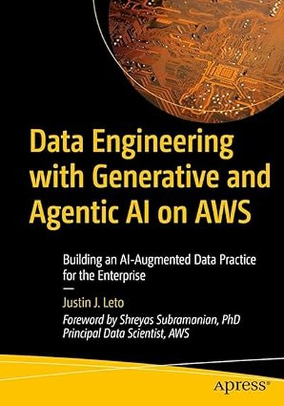

<p align="center">
  <a href="https://agenticdataengineering.ai">
    
  </a>
</p>

# Data Engineering with Generative and Agentic AI on AWS
### Building an AI-Augmented Data Practice for the Enterprise

By **Justin J. Leto** · Foreword by **Shreyas Subramanian, PhD** (Principal Data Scientist, AWS) · Apress, 2026 · Book site: **<https://agenticdataengineering.ai>** · Apress GitHub: **<https://github.com/Apress/Data-Engineering-with-Generative-and-Agentic-AI-on-AWS>**

> The hands-on guide to designing intelligent data platforms with cutting-edge AI capabilities and modern AWS services.

This repository is an **extension of the book** — every chapter folder maps to a
book chapter and ships the deployable code, CloudFormation, Python, SQL, and
notebook artifacts the chapter walks through. The chapter `README.md` describes
what each project deploys; you run the code against your own AWS account as you
read.

The goal across chapters is to show how generative AI changes the day-to-day
work of building and operating data platforms on AWS — from authoring
infrastructure in plain English, to agents that profile, design, and remediate
datasets autonomously, to text-to-SQL on top of a star-schema warehouse.

Start at [`01_intro/`](01_intro/README.md) — it sets up the AI coding
assistants used throughout the book and walks you through your first
CloudFormation deploy.

---

## Quick start

```bash
git clone <this repo>
cd data-engineering-with-aws-and-generative-ai

# 1. Make sure aws sts get-caller-identity returns your identity
#    — see "Before you start" below if it doesn't.
aws sts get-caller-identity

# 2. Install at least one of the four AI coding assistants.
#    See 01_intro/aidlc-setup/README.md.
cd 01_intro/aidlc-setup && cat README.md

# 3. Pick a chapter and let the assistant walk you through it.
cd ../../02_security/tls-load-balancer && claude
```

### Prerequisites

Beyond the AWS account / CLI setup in the next section, you need:

- **Python 3.12+** (`uv` or `pip`). A handful of agent projects also
  install fine on 3.11; AgentCore-bound agents pin 3.13 in their
  `Dockerfile` and bring their own runtime, so the local Python only
  needs to be new enough to run the deploy scripts.
- **Docker** or **[Finch](https://runfinch.com/)** — required for every
  AgentCore agent (chapters 05, 06, 12). Each `deploy.sh` builds an
  ARM64 container image and pushes it to ECR; `docker buildx` (or
  `finch build --platform linux/arm64`) is what does the build. CDK
  projects (chapter 02 audit-trail, chapter 03 medallion starter, the
  finops stack) also use Docker for asset bundling.
- **Node.js 18+** for any project deployed via CDK or that ships a
  TypeScript sibling (the `devops-data-engineering/reference-pipeline/`
  comparison stack).
- **`jq`** — used by every `deploy.sh` / `teardown.sh` to parse AWS CLI
  output.

---

## Multi-agent systems on AgentCore

Several chapters ship Strands agents deployed to **Amazon Bedrock
AgentCore Runtime** — long-running container endpoints that can run for
up to 8 hours per invocation, expose either an IAM/SigV4 or Cognito JWT
auth surface, and (optionally) advertise tools through AgentCore Gateway
as MCP. Once you've worked through chapters 5, 6, and 12 individually,
chapter 12 also ships an **orchestrator agent** that fronts all eleven of
them and routes every data-engineering request to the right specialist
(or chains several together for multi-step pipelines).

All projects in this repo default to **us-east-1**. Every `deploy.sh`,
`teardown.sh`, and CLI honors an `AWS_REGION=…` env var override, so you
can pick another region; just stay consistent — agents that talk to each
other (the orchestrator → specialists, the sales agent → MCP server)
must share a region.

The 11 specialist agents the orchestrator routes to:

| Runtime                           | Default region | Source                                                                                                         | Capability |
|-----------------------------------|----------------|----------------------------------------------------------------------------------------------------------------|------------|
| `data_profiling_agent`            | us-east-1      | [`05_bigdata/data-profiling-agent`](05_bigdata/data-profiling-agent/)                                          | DataBrew profile of an S3 dataset |
| `data_contract_agent`             | us-east-1      | [`05_bigdata/data-contract-agent`](05_bigdata/data-contract-agent/)                                            | Author a YAML data contract from a profile, or diff an existing contract against the live Glue table; compile contract clauses to Deequ checks |
| `data_architect_agent`            | us-east-1      | [`05_bigdata/data-architect-agent`](05_bigdata/data-architect-agent/)                                          | Schema design + Glue registration + ETL |
| `data_quality_deequ_agent`        | us-east-1      | [`05_bigdata/data-quality-deequ-agent`](05_bigdata/data-quality-deequ-agent/)                                  | Deequ constraint suggestion + verification |
| `data_quality_agent`              | us-east-1      | [`05_bigdata/data-quality-agent`](05_bigdata/data-quality-agent/)                                              | Failed-constraint remediation plan |
| `api_integration_agent`           | us-east-1      | [`05_bigdata/api-integration-agent`](05_bigdata/api-integration-agent/)                                        | Generate + deploy an API ingestion Lambda |
| `log_analysis_agent`              | us-east-1      | [`06_orchestration/log-analysis-agent`](06_orchestration/log-analysis-agent/)                                  | Root-cause Airflow + Spark pipeline failures |
| `text_to_dag_agent`               | us-east-1      | [`06_orchestration/text-to-dag-agent`](06_orchestration/text-to-dag-agent/)                                    | NL → Step Functions ASL or Airflow DAG |
| `sql_evaluations_agent`           | us-east-1      | [`12_agentic/agent/sql-evaluations-agent`](12_agentic/agent/sql-evaluations-agent/)                            | SQL review (errors, optimization, security) |
| `sales_reporting_agent`           | us-east-1      | [`12_agentic/agent/sales-reporting-agent`](12_agentic/agent/sales-reporting-agent/)                            | NL questions against the chapter-10 Redshift sales schema |
| `redshift_mcp_server_agentcore`   | us-east-1      | [`12_agentic/mcp/02-hosting-MCP-server`](12_agentic/mcp/02-hosting-MCP-server/)                                | Redshift MCP server (introspection + execute_query) |

### Deploy all the specialists, then the orchestrator

Each project is a one-shot `bash deploy.sh` (idempotent — re-running
updates in place). The orchestrator discovers downstream agents at deploy
time, so deploy any specialists you want it to know about first.

```bash
# Chapter 05 specialists (us-east-1 by default — set AWS_REGION to override)
for d in 05_bigdata/{data-profiling-agent,data-contract-agent,data-architect-agent,\
data-quality-deequ-agent,data-quality-agent,api-integration-agent}; do
  ( cd "$d" && bash deploy.sh )
done

# Chapter 06 specialists
for d in 06_orchestration/{log-analysis-agent,text-to-dag-agent}; do
  ( cd "$d" && bash deploy.sh )
done

# Chapter 12 — Redshift MCP server, SQL evaluator, sales agent
( cd 12_agentic/mcp/02-hosting-MCP-server && \
    COGNITO_PASSWORD='<choose-a-password>' \
    python3 deploy_redshift_mcp.py )

( cd 12_agentic/agent/sql-evaluations-agent && bash deploy.sh )

# Sales agent (uses agentcore CLI; see chapter 12 README for the full
# Cognito / Memory bootstrap):
( cd 12_agentic/agent && \
    export COGNITO_PASSWORD='...' REDSHIFT_PASSWORD='...' && \
    ./create_sales_agent_execution_role.sh && \
    ./sales_agent_setup_cognito.sh && \
    cd sales-reporting-agent && \
    SALES_MEMORY_ID='<your-AgentCore-memory-id>' \
    agentcore configure -e sales_reporting_agent.py --requirements-file requirements.txt && \
    agentcore launch )

# Orchestrator (after every specialist above is READY)
( cd 12_agentic/agent/data-engineering-orchestrator-agent && bash deploy.sh )
```

The orchestrator's `deploy.sh` lists AgentCore Runtimes across the
configured region(s), joins them with a built-in spec of well-known
names (`data_profiling_agent`, `data_architect_agent`, `sql_evaluations_agent`, …), and bakes the
resulting registry into the runtime's `AGENT_REGISTRY_JSON` env var.
Re-run `deploy.sh` after adding or replacing any specialist so the
orchestrator picks up the new ARN.

> Skipping any specialist is fine — the orchestrator's registry just
> shrinks. The chapter-12 README covers each agent's prerequisites
> (DataBrew quota, Redshift cluster, etc.) in detail.

### Invoke the orchestrator

```bash
AGENT_RUNTIME_ARN=$(aws ssm get-parameter --name /data-engineering-orchestrator-agent/agent_runtime_arn \
  --query Parameter.Value --output text)

AGENT_RUNTIME_ARN="$AGENT_RUNTIME_ARN" \
  python3 12_agentic/agent/data-engineering-orchestrator-agent/scripts/invoke_runtime.py \
  "Review this SQL: SELECT * FROM users WHERE name LIKE '%a%'"
```

The response is always a single JSON object:

```json
{
  "plan": "1-3 sentence routing decision",
  "agents_invoked": ["sql_evaluations_agent"],
  "results": { "sql_evaluations_agent": { ...full agent response... } },
  "summary": "user-facing answer that synthesises the agent results"
}
```

Other example prompts:

```text
"Profile s3://my-bucket/landing/orders.csv"
"Run a full medallion pipeline on s3://…/landing/orders.csv:
   profile, design, run quality, and remediate any failures."
"What were total Q3 sales by region?"
"Convert this description to a Step Functions DAG: every hour, pull the
   latest orders from the Stripe API, validate, then load to Redshift."
"Why did pipeline run pipeline-runs/run-2024-09-30T01.json fail?"
```

For full architecture diagrams, the routing decision rules, polling
tools, IAM scoping, and the latest 10/10 routing test results, see
[`12_agentic/agent/data-engineering-orchestrator-agent/README.md`](12_agentic/agent/data-engineering-orchestrator-agent/README.md)
and the supporting chapter-12 README at
[`12_agentic/README.md`](12_agentic/README.md).

---

## Before you start: AWS account + CLI credentials

Every chapter calls AWS APIs from your laptop or from the AI coding assistant
running on your laptop. If you don't already have an AWS account and a
working `aws` CLI, do the steps in this section first. Allow ~30 minutes for
a brand-new account.

If `aws sts get-caller-identity` already returns your identity, skip ahead to
[`01_intro/aidlc-setup/`](01_intro/aidlc-setup/README.md).

### 1. Create an AWS account

1. Open <https://portal.aws.amazon.com/billing/signup> in a private browser
   window.
2. Provide an email address you control, a strong password, and an **AWS
   account name** (this becomes the human label for the account — e.g.
   `yourname-book-sandbox`).
3. Choose **Personal** account type and fill in your contact information.
4. Enter a credit or debit card. AWS authorises a small amount (refunded) to
   verify the card. Most chapters in this book stay within the
   [AWS Free Tier](https://aws.amazon.com/free/), but a few (Redshift,
   QuickSight, MWAA, AgentCore) bill by the hour — tear them down when
   finished.
5. Verify your phone number with the SMS or voice code AWS sends.
6. Pick the **Basic Support — Free** plan unless you have a reason to
   upgrade.

You will land in the AWS Management Console signed in as the **root user**.
Do not use the root user for daily work — the next two steps lock it down and
create a non-root identity for the CLI.

### 2. Secure the root user

From the console, top-right account menu → **Security credentials**:

1. **Enable MFA on the root user.** Choose a virtual authenticator app
   (1Password, Authy, Google Authenticator) or a hardware key. Without MFA,
   anyone with your email + password can take over the account.
2. **Delete any root access keys** if the page lists them. Root keys should
   never exist; if AWS prompts you to create one for the CLI, decline — you
   will create scoped keys for a non-root identity instead.
3. Set a billing alert: **Billing and Cost Management → Budgets → Create
   budget**. A monthly budget of $10–$50 with email alerts at 50% / 80% /
   100% catches forgotten resources before they get expensive.

Sign out of the root user. From here on, log in as the identity you create
in step 3.

### 3. Create a CLI identity (IAM Identity Center — recommended)

AWS recommends [IAM Identity Center](https://docs.aws.amazon.com/singlesignon/latest/userguide/what-is.html)
(formerly AWS SSO) over long-lived IAM user keys. Identity Center issues
short-lived credentials that the CLI refreshes automatically — safer if your
laptop is ever lost or your shell history is shared with an AI assistant.

1. Sign in as root one more time, switch the console region to one near you
   (e.g. `us-east-1`), and open **IAM Identity Center**.
2. Click **Enable**. Accept the default AWS-managed directory.
3. **Users → Add user.** Create a user for yourself with your real email.
   Identity Center emails an invitation to set a password and enroll MFA.
4. **Permission sets → Create permission set → Predefined →
   `AdministratorAccess`.** (You can scope this down later — for the book's
   sandbox account, admin is fine.)
5. **AWS accounts → select your account → Assign users or groups.** Pick
   your user, attach the `AdministratorAccess` permission set, submit.
6. Note the **AWS access portal URL** shown on the Identity Center
   dashboard — it looks like `https://d-xxxxxxxxxx.awsapps.com/start`. You
   will use this URL when configuring the CLI.

Sign out of root. Sign in to the access portal as your new user, complete
the password reset, and enroll MFA.

> **Alternative — IAM user with access keys.** If your organisation forbids
> Identity Center, create an **IAM user** in the IAM console, attach
> `AdministratorAccess`, then **Security credentials → Create access key →
> Command Line Interface**. You will paste the access key ID and secret in
> step 5 below. Keys are long-lived, so rotate them every 90 days and never
> commit them.

### 4. Install the AWS CLI v2

Pick your platform. All of these install `aws` v2; v1 is end-of-life and
not supported by this book.

**macOS (Homebrew):**

```bash
brew install awscli
aws --version    # expect aws-cli/2.x
```

**macOS (official installer):** download the `.pkg` from
<https://awscli.amazonaws.com/AWSCLIV2.pkg> and double-click.

**Linux (x86_64):**

```bash
curl "https://awscli.amazonaws.com/awscli-exe-linux-x86_64.zip" -o awscliv2.zip
unzip awscliv2.zip
sudo ./aws/install
aws --version
```

**Linux (arm64):** swap `x86_64` for `aarch64` in the URL above.

**Windows (PowerShell):**

```powershell
msiexec.exe /i https://awscli.amazonaws.com/AWSCLIV2.msi
aws --version
```

Open a fresh shell after install so the PATH update takes effect.

### 5. Configure credentials

#### Option A — Identity Center (recommended)

```bash
aws configure sso
```

The wizard prompts for:

- **SSO session name:** anything memorable, e.g. `book`.
- **SSO start URL:** the access portal URL from step 3 (the
  `https://d-xxxxxxxxxx.awsapps.com/start` one).
- **SSO region:** the region where you enabled Identity Center.
- **CLI default Region:** `us-east-1` is a safe default — most chapters use
  it.
- **CLI default output format:** `json`.
- **CLI profile name:** `book-sandbox` (used in the rest of this book).

A browser window opens for you to approve the device. After approval, the
CLI writes a profile to `~/.aws/config`. To refresh expired credentials
later:

```bash
aws sso login --profile book-sandbox
```

Set the profile for your shell so every chapter picks it up automatically:

```bash
export AWS_PROFILE=book-sandbox
# add the same line to ~/.zshrc or ~/.bashrc to make it persistent
```

#### Option B — IAM user access keys

```bash
aws configure --profile book-sandbox
```

Paste the access key ID and secret from step 3, set the default region to
`us-east-1`, and the output format to `json`. Then export the profile as
above.

### 6. Verify

```bash
aws sts get-caller-identity
```

You should see a JSON document with your account ID and the ARN of the
identity you set up. If you see an `Unable to locate credentials` error,
re-check `AWS_PROFILE` and rerun `aws sso login` (Option A) or
`aws configure` (Option B).

That's the floor every chapter assumes. Continue to
[`01_intro/aidlc-setup/`](01_intro/aidlc-setup/README.md) to install the AI
coding assistants used to drive the rest of the book.

---

## Chapter inventory

Each chapter is a self-contained folder. The synopsis explains what the
chapter teaches; the value prop is what you get out of running its code; the
project list is the deployable artifacts inside.

### `01_intro/` — Getting set up

**Synopsis.** Installs the four terminal-based AI coding assistants used
throughout the book (Claude Code, Kiro CLI, Codex CLI, Cursor CLI) plus the
AI-DLC spec-driven workflow with this book's data-engineering extension
pack.

**Value prop.** By the end of this chapter you have a credentialed laptop,
at least one working AI assistant, and the AI-DLC rule packs ready for use
across every later chapter.

| Project | What it does |
|---|---|
| [`aidlc-setup/`](01_intro/aidlc-setup/) | Install + auth guide for Claude Code, Kiro CLI, Codex CLI, Cursor CLI; AI-DLC core workflow + 7 data-engineering rule packs (baseline, s3-lakehouse, glue-etl, redshift, orchestration, catalog, cicd); per-chapter tool recommendations. |

### `02_security/` — Data security and governance

**Synopsis.** Encryption with customer-managed KMS keys, fine-grained
column/row access in Lake Formation and Redshift, secure MCP server
patterns (OAuth 2.1 + PKCE and SigV4), Bedrock Guardrails generated from
corporate AUP policies, a 210-payload prompt-injection test harness, and
a governance-grade audit trail for Bedrock invocations. Closes with a
four-project FinOps stack for generative-AI workloads.

**Value prop.** Production-leaning building blocks for the security and
cost-control layer of an AI-augmented data platform — most ship with unit
tests that run with no AWS creds.

| Project | What it does |
|---|---|
| [`tls-load-balancer/`](02_security/tls-load-balancer/) | CloudFormation template + AI-driven walkthrough for the chapter's "encrypt data-in-transit" pattern: Route 53 → ACM → ALB with HTTPS listener and HTTP→HTTPS redirect. |
| [`encryption-kms/`](02_security/encryption-kms/) | Notebook that creates a customer-managed KMS key and applies SSE-KMS to an S3 bucket — the canonical CMK workflow. |
| [`fine-grained-access/`](02_security/fine-grained-access/) | Lake Formation column-scoped grants via `boto3`, plus Redshift column-level and row-level security SQL samples. |
| [`mcp-oauth-reference-server/`](02_security/mcp-oauth-reference-server/) | OAuth 2.1 + PKCE reference MCP server with Cognito as IdP, Dynamic Client Registration via FastAPI proxy, JWT validation, and a reference client. CloudFormation included. |
| [`sigv4-mcp-bridge/`](02_security/sigv4-mcp-bridge/) | Drop-in Python middleware so any Strands agent can call MCP servers via SigV4 instead of OAuth — for internal AWS-to-AWS traffic where the caller is already an IAM principal. |
| [`guardrails-from-policy/`](02_security/guardrails-from-policy/) | `policy2guardrail` CLI: ingests a policy PDF/DOCX/TXT, has Claude extract denied topics + PII entity types + filter strengths, and deploys an Amazon Bedrock Guardrail. 57 unit tests; idempotent deploy. |
| [`prompt-injection-test-harness/`](02_security/prompt-injection-test-harness/) | 210 prompt-injection payloads across 10 attack categories, runnable against any Bedrock model, deployed Bedrock Agent, or custom callable. CLI, JUnit XML output, GitHub Actions workflow. |
| [`bedrock-audit-trail/`](02_security/bedrock-audit-trail/) | CDK stack that turns Bedrock invocation logs into a partitioned Iceberg dataset; KMS-encrypted S3 + CloudWatch sinks, Firehose with Comprehend PII tokenisation, six Athena query templates, four-sheet QuickSight dashboard, five CloudWatch alarms. |
| [`config-rules-for-genai/`](02_security/config-rules-for-genai/) | AWS Config rules tailored for generative-AI workloads (model access, guardrail attachment, logging). |
| [`finops/`](02_security/finops/) | Four-project FinOps stack for AI workloads: AI FinOps data lake (foundation), agent run cost tracer, model cascade router (cheapest-model routing with eval gate), token budget circuit breaker (enforcement, not just monitoring). |

### `03_datalake/` — Data lake on S3 + Iceberg

**Synopsis.** A working medallion-style data lake on S3 with Apache Iceberg,
plus AI-augmented tooling around it: schema annotation via Bedrock, a
read-only maturity scanner, time-travel debugging, schema-evolution chaos
testing, and an autonomous Iceberg maintenance agent.

**Value prop.** Reduces the effort of bootstrapping and operating an Iceberg
lakehouse — one-command CDK deploy of the whole 7-stage architecture, plus
the AI-assisted operations tooling that doesn't ship out of the box.

| Project | What it does |
|---|---|
| [`progressive-medallion-starter-kit/`](03_datalake/progressive-medallion-starter-kit/) | One-command CDK deploy of a 7-stage medallion architecture: 7 S3 buckets, 5 Glue databases, Lake Formation LF-Tags, crawlers, CDC ingest pipeline, Athena workgroup. |
| [`data-ingestion-to-s3/`](03_datalake/data-ingestion-to-s3/) | Lambda that fetches Bitcoin price JSON and writes it to S3 — the simplest "raw zone" producer. |
| [`data-catalog/`](03_datalake/data-catalog/) | Time-partitioned Bitcoin ingestion with a Glue crawler, Bedrock-driven schema annotation, drift alerting, and governance tagging. |
| [`iceberg-maintenance-agent/`](03_datalake/iceberg-maintenance-agent/) | Autonomous agent that runs OPTIMIZE / VACUUM / expire-snapshots against Iceberg tables on a schedule. |
| [`iceberg-time-travel-debugger/`](03_datalake/iceberg-time-travel-debugger/) | CLI that diffs two Iceberg snapshots and emits a row-level changelog using Athena `FOR VERSION AS OF`. Useful for "what changed last night" investigations. |
| [`schema-evolution-simulator/`](03_datalake/schema-evolution-simulator/) | Chaos-engineering tool that runs 12 safe / unsafe / chaos schema mutations against a live Athena Iceberg table and validates downstream-consumer behaviour. |
| [`lakeformation-bootstrap/`](03_datalake/lakeformation-bootstrap/) | Sets up a Lake Formation admin and the LF-Tag taxonomy used by other projects. |
| [`lakeformation-data-filters/`](03_datalake/lakeformation-data-filters/) | Two analyst personas, one IMDB principals table — Lake Formation column- and row-level filters demonstrate fine-grained access in practice. |
| [`datalake-maturity-assessment/`](03_datalake/datalake-maturity-assessment/) | Read-only scanner that scores an AWS data lake against eight maturity dimensions and emits an evidence-backed report + prioritised remediation backlog mapped to book chapters. |

### `04_datamesh/` — Data mesh on Amazon DataZone

**Synopsis.** Closes the IaC and governance gaps that DataZone ships with:
declarative YAML manifests for domains and projects, automatic glossary +
PII tagging via Bedrock, federated lineage rendering, and a contract
validator that gates publishes on breaking changes.

**Value prop.** Gives a real shape to "data mesh on AWS" — DataZone is
powerful but operationally raw, and these projects supply the missing
plumbing.

| Project | What it does |
|---|---|
| [`datazone-as-code/`](04_datamesh/datazone-as-code/) | Declarative YAML → DataZone domains, units, projects, owners, policy grants, glossaries, terms. Idempotent apply + cascading teardown. |
| [`auto-cataloger/`](04_datamesh/auto-cataloger/) | Bedrock-powered job that walks a Glue database, samples rows, and writes back column descriptions, glossary suggestions, and PII tags as Glue metadata that DataZone inherits automatically. |
| [`cross-domain-lineage/`](04_datamesh/cross-domain-lineage/) | Reads DataZone subscriptions and OpenLineage events; renders a domain-unit-to-domain-unit dependency graph (Mermaid + interactive HTML) for federated governance reviews. |
| [`data-product-validator/`](04_datamesh/data-product-validator/) | Validates a DataZone asset against a YAML data contract and refuses to publish on breaking changes (column missing, type changed). Exits non-zero in CI. |
| [`datamesh-maturity-assessment/`](04_datamesh/datamesh-maturity-assessment/) | Read-only scoring of a live DataZone deployment against Zhamak Dehghani's four data-mesh principles, with a prioritised remediation list (Markdown + JSON). |

### `05_bigdata/` — Big-data ETL and the agentic pipeline

**Synopsis.** The most ambitious chapter. Starts with classical Glue ETL
(API ingestion → DataBrew profiling → Deequ data quality), then chains four
**Strands agents on Bedrock AgentCore Runtime** that profile, design,
quality-check, and remediate datasets autonomously — each agent producing
JSON the next consumes. Includes a Kiro spec-driven pipeline as an
alternative authoring style.

**Value prop.** Demonstrates an agentic pipeline that turns "a new file
landed in S3" into "a curated, quality-checked, registered dataset with a
remediation plan" without an engineer in the loop.

| Project | What it does |
|---|---|
| [`lambda-api-ingestion/`](05_bigdata/lambda-api-ingestion/) | Lambda that pulls JSON from a third-party API and writes it to the lake's landing zone. |
| [`glue-databrew-profiling/`](05_bigdata/glue-databrew-profiling/) | Lambda that creates and runs a Glue DataBrew profiling job over a landed dataset. |
| [`glue-deequ-data-quality/`](05_bigdata/glue-deequ-data-quality/) | Glue PySpark job that applies Amazon Deequ constraints to curated data. |
| [`api-integration-agent/`](05_bigdata/api-integration-agent/) | Strands agent on AgentCore Runtime that takes a target dataset and an API spec, then writes, deploys, schedules, and live-tests a Lambda that pulls data into the landing zone. Six MCP tools behind one Lambda exposed via AgentCore Gateway. |
| [`data-profiling-agent/`](05_bigdata/data-profiling-agent/) | Triggers on `s3://.../landing/*`, runs DataBrew + an LLM analysis, emits an insights JSON (schema, primary-key candidates, partition candidates, PII, domain). |
| [`data-architect-agent/`](05_bigdata/data-architect-agent/) | Consumes the profiling agent's insights, designs the schema, registers raw + curated tables in Glue, runs the first ETL, materialises curated Parquet — all in one invocation. |
| [`data-quality-deequ-agent/`](05_bigdata/data-quality-deequ-agent/) | Consumes the architect's design, runs Deequ constraint suggestions + verification on the curated table, registers the verification report as a Glue table, emits a quality insights JSON. |
| [`data-quality-agent/`](05_bigdata/data-quality-agent/) | Consumes the Deequ insights, investigates failed constraints (peeks failing rows, reads history), and writes an actionable remediation plan an engineer can pick up. |
| [`kiro-data-pipeline/`](05_bigdata/kiro-data-pipeline/) | Kiro-spec-driven pipeline over Chicago violations data — same problem, IDE-spec authoring style, useful as a comparison. |

### `06_orchestration/` — Generative AI for orchestration

**Synopsis.** Generative-AI authoring of AWS Step Functions and Airflow
DAGs, plus pipeline cost attribution for shared-services platforms and a
log-analysis agent for on-call.

**Value prop.** Turns the orchestration layer's pain points (writing ASL by
hand, tagging, log triage) into either one-shot Lambda generators or
EventBridge-triggered agents.

| Project | What it does |
|---|---|
| [`step-function-generator/`](06_orchestration/step-function-generator/) | S3-triggered Lambda that takes a natural-language prompt, calls Claude on Bedrock, validates the returned ASL JSON against an allowlist, and creates or updates a Step Functions state machine. |
| [`text-to-dag-agent/`](06_orchestration/text-to-dag-agent/) | Strands agent on AgentCore Runtime that turns NL pipeline descriptions into validated Step Functions ASL or Airflow DAGs. Tools exposed via AgentCore Gateway. |
| [`pipeline-cost-attribution/`](06_orchestration/pipeline-cost-attribution/) | Chargeback for shared data platforms: EventBridge-driven tag enforcer plus a Cost Explorer aggregator that lands per-team / per-BU / per-pipeline spend in Athena. |
| [`log-analysis-agent/`](06_orchestration/log-analysis-agent/) | EventBridge-triggered Strands agent that consumes a pipeline-run descriptor, tails Airflow + Spark logs from S3 / CloudWatch, emits structured insights JSON, and posts a one-line headline to SNS. |

### `07_enrichment/` — Multimodal enrichment and IDP

**Synopsis.** Side-by-side comparisons of AWS purpose-built AI services
(Rekognition, Textract) versus a multimodal foundation model (Claude Sonnet
on Bedrock), plus a curated library of Amazon Bedrock Data Automation custom
blueprints with a labelled corpus and a diff-based test harness.

**Value prop.** Concrete accuracy / latency / effort numbers on the
classical-AI-vs-FM tradeoff for both image enrichment and document
processing — and a deployable BDA blueprint library you can extend.

| Project | What it does |
|---|---|
| [`multimodal-enrichment/`](07_enrichment/multimodal-enrichment/) | Two notebooks (image enrichment, IDP) that run Rekognition / Textract and Claude on the same inputs, print latency, and show raw output. Includes a hybrid section that augments Claude with Textract output. |
| [`bda-blueprint-library/`](07_enrichment/bda-blueprint-library/) | Six Bedrock Data Automation blueprints (invoice, bill of lading, K-1, lease abstract, MSA, purchase order) with labelled corpus, idempotent BDA deploy, and a test harness that diffs BDA output against ground truth. |

### `08_rag/` — Retrieval-augmented generation

**Synopsis.** A small RAG pipeline on Amazon S3 Vectors and Bedrock Titan
Text Embeddings v2 — real loaders, token-aware chunking, metadata filtering,
idempotent setup, and a pytest suite.

**Value prop.** The book's RAG primer in runnable form: a 5-step CLI from
ingest → query → filter → stats → clean, on a vector store you don't have
to provision yourself.

| Project | What it does |
|---|---|
| [`s3_vectors/`](08_rag/s3_vectors/) | Library + CLI for ingesting documents, querying by similarity, filtering by metadata, and tearing down the index. Sample data and an end-to-end demo script included. |
| [`knowledge-graph-agent/`](08_rag/knowledge-graph-agent/) | Production GraphRAG: Bedrock-driven entity/relationship extraction (Claude 3.7 Sonnet) + Amazon Nova Multimodal Embeddings, property graph on Amazon Neptune Analytics, hybrid graph + vector retrieval, and an MCP server on AgentCore Runtime with a reference Strands agent. PE due-diligence flagship example. |

### `09_streaming/` — Streaming with Bedrock in the loop

**Synopsis.** Two streaming demos that put a foundation model on the hot
path: Kinesis-backed stock trades landing in S3 Tables (Iceberg) with
Bedrock-driven trend analysis, and a social-media sentiment pipeline with
both a Lambda and a Managed Service for Apache Flink implementation.

**Value prop.** Shows what changes when the enrichment step is an LLM —
async I/O, batching, exactly-once delivery, and ACID landing on Iceberg —
not just "Kinesis → S3."

| Project | What it does |
|---|---|
| [`stock-trading-demo/`](09_streaming/stock-trading-demo/) | Trade generator → Kinesis → Firehose → S3 Tables (Iceberg) with UPSERTs, plus a trend-analysis Lambda that calls Bedrock Claude Haiku 4.5 and posts SNS alerts. |
| [`streaming-sentiment-demo/`](09_streaming/streaming-sentiment-demo/) | Posts → Kinesis → processor + sentiment analysis (Claude 3.5 Haiku on Bedrock) → S3, with two implementations: simple Lambda pipeline and a Managed Service for Apache Flink job using Async I/O for high-volume / exactly-once workloads. |

### `10_datamart/` — Redshift + text-to-SQL

**Synopsis.** A complete star-schema sales mart on Redshift RA3 with a
natural-language query interface: Bedrock TextToSQL agent, Claude Sonnet
fallback, Lambda + API Gateway, and a single-page HTML frontend.

**Value prop.** Run-it-yourself reference for "let business users ask
questions of the warehouse in English" — automated deploy includes IAM,
S3, the Redshift cluster, schema, data load, and the text-to-SQL API as a
separate CFN stack.

| Project | What it does |
|---|---|
| [`redshift_demo/`](10_datamart/redshift_demo/) | One-shot deploy of a Faker-generated star schema on Redshift, plus a CFN stack that fronts it with a text-to-SQL API and HTML frontend. Used by chapters 11 and 12 as the source warehouse. |

### `11_quicksight/` — QuickSight Q natural-language BI

**Synopsis.** Sets up Amazon QuickSight Q on top of the chapter-10 Redshift
sales cluster: data source, SPICE dataset with calculated fields, Q topic
(semantic layer), IAM/networking glue.

**Value prop.** A reproducible "natural-language dashboards" demo that
builds on the same warehouse the rest of the book uses, so business-user
QnA and engineer-grade text-to-SQL share a back end.

| Project | What it does |
|---|---|
| [`quicksight-q-demo/`](11_quicksight/quicksight-q-demo/) | Scripts that provision the QuickSight → Redshift connection, SPICE-backed dataset, Q topic with semantic types and default aggregations, and the least-privilege IAM and security-group rules QuickSight needs. |

### `12_agentic/` — Agentic AI on AWS (Bedrock AgentCore)

**Synopsis.** A complete agentic application built on Bedrock AgentCore
Runtime: a Strands sales-reporting agent that authenticates via Cognito,
calls a Redshift-backed MCP server (also hosted on AgentCore), uses an
independent SQL-evaluations agent to review its own queries before
execution, and a **data-engineering orchestrator agent** that fronts every
other AgentCore-deployed specialist in the book and routes incoming
requests to the right one (or chains several together).

**Value prop.** End-to-end pattern for "production-shaped" agents on AWS —
how to deploy MCP servers as managed runtimes, broker auth, share memory
across invocations, review LLM-generated SQL before it touches a
warehouse, and orchestrate multi-agent workflows where one front-door
agent dispatches to ten specialised ones across regions and auth schemes.

| Project | What it does |
|---|---|
| [`agent/data-engineering-orchestrator-agent/`](12_agentic/agent/data-engineering-orchestrator-agent/) | Strands orchestrator on AgentCore Runtime that receives every data-engineering request and routes it to the right specialist agent. Discovers downstream agents at deploy time across `us-east-1` + `us-west-2`, handles both IAM/SigV4 and Cognito JWT auth uniformly, and exposes polling tools (Glue / Step Functions / CloudWatch) for long-running infra. See [its README](12_agentic/agent/data-engineering-orchestrator-agent/README.md) and the [latest 10/10 routing test results](12_agentic/agent/data-engineering-orchestrator-agent/tests/results.md). |
| [`mcp/02-hosting-MCP-server/`](12_agentic/mcp/02-hosting-MCP-server/) | Hosts the `awslabs/redshift-mcp-server` tools (`execute_redshift_query`, cluster/database/table introspection) on Bedrock AgentCore Runtime. Includes deploy + teardown scripts and a tutorial notebook. |
| [`agent/sales-reporting-agent/`](12_agentic/agent/sales-reporting-agent/) | Strands agent on AgentCore Runtime that authenticates against the MCP server (Cognito), turns natural-language sales questions into Redshift SQL, and uses AgentCore memory across runs. |
| [`agent/sql-evaluations-agent/`](12_agentic/agent/sql-evaluations-agent/) | Independent SQL reviewer on AgentCore (also exposed as an MCP tool via AgentCore Gateway) that the sales agent calls before executing — a guardrail pattern for LLM-generated SQL. |
| [`agent/online-agent-evaluation/`](12_agentic/agent/online-agent-evaluation/) | Production monitoring that discovers every Bedrock agent in the account (AgentCore Runtimes + classic Bedrock Agents in `us-east-1` and `us-west-2`) and attaches a sampled LLM-as-judge evaluator. Verdicts land as CloudWatch metrics, structured logs, JSONL in S3, and a daily Bedrock Evaluations batch job — agents themselves never call the evaluator, so production latency is unaffected. |

### `devops-data-engineering/` — DevOps for data pipelines and agents

**Synopsis.** A companion chapter codebase that wraps the rest of the book
in production-grade DevOps practice: Terraform-primary IaC (with a CDK
side-by-side), pre-commit security hooks, ephemeral per-PR sandbox
environments, OPA / Conftest / Checkov policy gates, the four-layer testing
model for data pipelines (unit / contract / integration / smoke+DQ),
GitHub Actions CI/CD with OIDC, deploy-tied observability and rollback,
and an agentic / MCP DevOps lab that gates evals, prompt-injection
regression, and guardrail attachment as deploy preconditions.

**Value prop.** Replaces the "click in the console, edit the Glue job in
place, redeploy from a laptop" default with a `git → hooks → CI → sandbox
→ policy gates → prod → observability + rollback` pipeline tuned for
stateful data work and non-deterministic agent components — illustrated
on a runnable reference pipeline (S3 → Glue → Step Functions → Athena →
AgentCore) that mirrors a slice of chapter codebases 5, 6, and 12.

| Project | What it does |
|---|---|
| [`reference-pipeline/`](devops-data-engineering/reference-pipeline/) | One pipeline expressed twice: Terraform (primary, with `envs/sandbox` + `envs/prod` and modules for Glue, orchestration, observability) and TypeScript CDK (comparison). PySpark Glue jobs follow the pure-function pattern so unit tests run locally; integration tests target the deployed sandbox. |
| [`labs/01-version-control-foundations/`](devops-data-engineering/labs/01-version-control-foundations/) | Trunk-based branching adapted for data work, monorepo vs polyrepo decision matrix, `CODEOWNERS` template that requires the right reviewer for IaC / DAGs / prompts, conventional commits with commitlint, semver of pipeline artifacts. |
| [`labs/02-pre-commit-security-hooks/`](devops-data-engineering/labs/02-pre-commit-security-hooks/) | `pre-commit` config wiring `gitleaks`, `detect-secrets`, `tflint`, `tfsec`, `checkov`, `bandit`, `ruff`, `sqlfluff`, `nbstripout`, plus a custom `block-aws-account-ids.sh` hook. Tuned for the data-eng foot-guns. |
| [`labs/03-iac-sandbox-environments/`](devops-data-engineering/labs/03-iac-sandbox-environments/) | Per-developer / per-PR ephemeral AWS sandboxes via Terraform workspaces, `TF_VAR_owner` blast-radius tagging, auto-teardown on PR close, scheduled stale-sandbox sweeper, AWS Budgets per owner. |
| [`labs/04-policy-as-code/`](devops-data-engineering/labs/04-policy-as-code/) | OPA / Conftest Rego policies + Checkov config that block public buckets, IAM `*` wildcards, untagged Glue jobs, Bedrock model invocations without an attached guardrail, and curated buckets without KMS in prod. |
| [`labs/05-pipeline-testing-strategy/`](devops-data-engineering/labs/05-pipeline-testing-strategy/) | The four test layers a data pipeline actually needs: JSON Schema contract tests on upstream APIs, Great Expectations-style YAML contracts on curated tables, an Athena-backed DQ runner, and post-deploy smoke tests. |
| [`labs/06-ci-cd-github-actions/`](devops-data-engineering/labs/06-ci-cd-github-actions/) | Reusable GitHub Actions workflows: PR (pre-commit + tests + plan + policy), per-PR sandbox apply + integration, merge-to-main staging deploy, tag → prod deploy with manual approval, scheduled drift detection, plan summary as PR comment. |
| [`labs/07-secrets-and-oidc/`](devops-data-engineering/labs/07-secrets-and-oidc/) | Replace long-lived AWS access keys in CI with GitHub OIDC → IAM role assumption, scoped per environment (sandbox / staging / prod), prod gated to release-tag refs only. Bootstrap script + role templates included. |
| [`labs/08-observability-and-rollback/`](devops-data-engineering/labs/08-observability-and-rollback/) | Structured-logging helper for Glue / Step Functions / AgentCore with a `deploy_id` correlation key, deploy-tied DQ alarms, automated rollback on alarm breach, Iceberg snapshot tagging on deploy for incident replay, schema-migration up/down pattern. |
| [`labs/09-agentic-and-mcp-devops/`](devops-data-engineering/labs/09-agentic-and-mcp-devops/) | What changes when LLMs are in the loop: prompts as versioned files with CODEOWNERS gates, eval suite with seeds + cost/latency budgets, prompt-injection regression wired to chapter 2's harness, Bedrock Guardrail attachment as a `lifecycle.precondition`, MCP tool-inventory diff CI. |

---

## Cost estimate per project (us-east-1)

These are sticker-price estimates for **leaving a project deployed for an
hour in us-east-1**, under a "light active workload" assumption — enough
real traffic to make the numbers honest, not a stress test. They are
upper-bounds for hands-on learning; tear stacks down when you're done
and the bill drops to the storage line ($0–$0.05/hr per project).

### Workload assumptions

| Knob | Assumption |
|---|---|
| Region | us-east-1 (every chapter defaults to this; see "Default region" in each chapter for overriding) |
| Lambda invocations | ~10/hour per project, 256 MB × 500 ms — pay-per-use, ~$0/hr |
| Bedrock calls | ~2/hour at ~1.5k input + ~500 output tokens (Claude Sonnet 3.5 / 4.5 unless noted) |
| Athena scans | ~100 MB/hour per project that scans (~$0.0005/hr) |
| S3 storage | <10 GB per demo project (~$0.0003/hr) — rolled into the rounding |
| AgentCore Runtime | 1 vCPU, 2 GB memory, idle most of the time — billed only while a request is being handled |
| Cognito | <50 MAU on the free tier; standing cost ~$0/hr |
| KMS CMK | $1/month per key ≈ $0.0014/hr |

The columns in the master table:

- **Hourly fixed** — what the stack burns even if no one calls it (Redshift, Neptune, Kinesis shards, etc.). This is the number that hurts if you forget to tear down.
- **Hourly active (light load)** — adds in the assumed traffic above.
- **Monthly active** — `hourly active × 730` (rounded), the line you'd see on a 30-day bill if you left the stack running 24/7.
- **Pay-per-use notes** — services that bill per call/scan/token and only show up if you exercise them.

### Master cost table

| Chapter | Project | Hourly fixed (idle) | Hourly active (light load) | Monthly active (× 730) | Dominant cost driver |
|---|---|---:|---:|---:|---|
| 01_intro | aidlc-setup | $0.0000 | $0.0000 | $0.00 | Local tooling only |
| 02_security | tls-load-balancer | $0.0225 | $0.0228 | $16.64 | ALB ($0.0225/hr) + ACM (free) + Route 53 hosted zone ($0.0007/hr) |
| 02_security | encryption-kms | $0.0014 | $0.0017 | $1.24 | KMS CMK ($1/mo ≈ $0.0014/hr); S3 + Bedrock pay-per-use |
| 02_security | fine-grained-access | $0.0000 | $0.0001 | $0.07 | SQL/scripts only — runs against your existing Redshift / Lake Formation |
| 02_security | mcp-oauth-reference-server | $0.0000 | $0.0001 | $0.07 | Cognito user pool — free tier, then $0.0055/MAU |
| 02_security | sigv4-mcp-bridge | $0.0000 | $0.0001 | $0.07 | Lambda only (pay-per-invoke) |
| 02_security | guardrails-from-policy | $0.0000 | $0.0010 | $0.73 | Bedrock Guardrail (no idle) + ApplyGuardrail @ $0.75/1M text units |
| 02_security | prompt-injection-test-harness | $0.0000 | $0.0050 | $3.65 | Pure test harness — Bedrock InvokeModel only when run |
| 02_security | bedrock-audit-trail | $0.0028 | $0.0048 | $3.50 | 2 KMS CMKs + Firehose volume; pay-per-use Lambda/Glue/Athena |
| 02_security | config-rules-for-genai | $0.0000 | $0.0010 | $0.73 | 9 Config rules (per-evaluation); recorder bills outside this stack |
| 02_security | finops/ai-finops-data-lake | $0.0014 | $0.0024 | $1.75 | KMS CMK; Glue + Athena + Lambda pay-per-use |
| 02_security | finops/agent-run-cost-tracer | $0.0014 | $0.0019 | $1.39 | KMS CMK + Firehose volume |
| 02_security | finops/model-cascade-router | $0.0014 | $0.0024 | $1.75 | KMS CMK; Bedrock evaluation jobs only on demand |
| 02_security | finops/token-budget-circuit-breaker | $0.0000 | $0.0010 | $0.73 | DynamoDB on-demand (PITR) — ~$0/hr at rest |
| 03_datalake | progressive-medallion-starter-kit | $0.0000 | $0.0030 | $2.19 | 8 S3 buckets + 5 Glue DBs; crawlers/Athena/Lambda pay-per-use |
| 03_datalake | data-ingestion-to-s3 | $0.0000 | $0.0001 | $0.07 | Single Lambda → S3 (no IaC) |
| 03_datalake | data-catalog | $0.0000 | $0.0030 | $2.19 | Hourly EventBridge-triggered ingest + Bedrock annotation calls |
| 03_datalake | iceberg-maintenance-agent | $0.0000 | $0.0001 | $0.07 | CLI only — operates on existing Iceberg tables |
| 03_datalake | iceberg-time-travel-debugger | $0.0000 | $0.0010 | $0.73 | Athena queries + S3 storage |
| 03_datalake | schema-evolution-simulator | $0.0000 | $0.0010 | $0.73 | Athena queries + S3 storage |
| 03_datalake | lakeformation-bootstrap | $0.0000 | $0.0005 | $0.37 | LF tags/grants — free; S3 + Glue catalog negligible |
| 03_datalake | lakeformation-data-filters | $0.0000 | $0.0005 | $0.37 | LF data-cell filters — free; Glue crawler on demand |
| 03_datalake | datalake-maturity-assessment | $0.0000 | $0.0001 | $0.07 | Read-only scanner — no resources |
| 04_datamesh | datazone-as-code | $0.0000 | $0.0014 | $1.02 | DataZone $0.10/asset/month once published |
| 04_datamesh | auto-cataloger | $0.0000 | $0.0030 | $2.19 | S3 + Glue catalog + Bedrock per row sampled |
| 04_datamesh | cross-domain-lineage | $0.0000 | $0.0001 | $0.07 | Read-only by default |
| 04_datamesh | data-product-validator | $0.0000 | $0.0001 | $0.07 | CLI only |
| 04_datamesh | datamesh-maturity-assessment | $0.0000 | $0.0001 | $0.07 | Read-only scanner |
| 05_bigdata | lambda-api-ingestion | $0.0000 | $0.0010 | $0.73 | Lambda + SQS + Secrets Manager ($0.40/mo per secret) |
| 05_bigdata | glue-databrew-profiling | $0.0000 | $0.0050 | $3.65 | DataBrew profile job ~$1.00/job-run when triggered |
| 05_bigdata | glue-deequ-data-quality | $0.0000 | $0.0050 | $3.65 | Glue 2-DPU job ~$0.88/hr only while running |
| 05_bigdata | kiro-data-pipeline | $0.0000 | $0.0050 | $3.65 | Glue Iceberg job pay-per-DPU-hour while running |
| 05_bigdata | api-integration-agent | $0.1080 | $0.1130 | $82.49 | **AgentCore Runtime** (1 vCPU + 2 GB ≈ $0.108/hr while serving) + Cognito + Lambda |
| 05_bigdata | data-profiling-agent | $0.1080 | $0.1180 | $86.14 | **AgentCore Runtime** + DataBrew per profile run |
| 05_bigdata | data-architect-agent | $0.1080 | $0.1130 | $82.49 | **AgentCore Runtime** + Glue catalog + Bedrock |
| 05_bigdata | data-quality-deequ-agent | $0.1080 | $0.1180 | $86.14 | **AgentCore Runtime** + Glue Deequ job per run |
| 05_bigdata | data-quality-agent | $0.1080 | $0.1130 | $82.49 | **AgentCore Runtime** + Athena lookups |
| 06_orchestration | step-function-generator | $0.0000 | $0.0030 | $2.19 | Lambda + Bedrock per generated state machine |
| 06_orchestration | text-to-dag-agent | $0.1080 | $0.1130 | $82.49 | **AgentCore Runtime** + Cognito |
| 06_orchestration | pipeline-cost-attribution | $0.0000 | $0.0020 | $1.46 | Lambda + Athena queries + S3 storage |
| 06_orchestration | log-analysis-agent | $0.1080 | $0.1180 | $86.14 | **AgentCore Runtime** + CloudWatch Logs scan + Bedrock |
| 07_enrichment | multimodal-enrichment | $0.0000 | $0.0500 | $36.50 | Notebooks only — Rekognition / Textract / Bedrock pay-per-call |
| 07_enrichment | bda-blueprint-library | $0.0000 | $0.0400 | $29.20 | BDA per-page custom-blueprint pricing when run |
| 08_rag | s3_vectors | $0.0000 | $0.0002 | $0.15 | S3 Vectors $0.06/1M vectors-mo + $0.001/1K queries |
| 08_rag | knowledge-graph-agent | **$0.1972** | **$0.3052** | **$222.80** | **Neptune Analytics 128 m-NCU** (~$0.197/hr always-on) + AgentCore Runtime + KMS + Cognito |
| 09_streaming | stock-trading-demo | $0.0550 | $0.1050 | $76.65 | **Kinesis 2 shards** ($0.030/hr) + S3 Tables base ($0.025/hr) + Firehose volume + Bedrock per analysis |
| 09_streaming | streaming-sentiment-demo (Lambda) | $0.0150 | $0.0750 | $54.75 | **Kinesis 1 shard** + Lambda + Bedrock Haiku per post |
| 09_streaming | streaming-sentiment-demo (+ Flink) | $0.1250 | $0.1850 | $135.05 | + **Managed Flink** 1 KPU @ $0.11/hr |
| 10_datamart | redshift_demo | **$6.5200** | **$6.5500** | **$4,781.50** | **Redshift ra3.4xlarge × 2 nodes** ($3.26/node-hr) — biggest line in the book |
| 11_quicksight | quicksight-q-demo | $0.0329 | $0.0339 | $24.75 | QuickSight Enterprise ~$24/user/mo ≈ $0.033/hr per author; SPICE storage negligible |
| 12_agentic | agent/sql-evaluations-agent | $0.1080 | $0.1130 | $82.49 | **AgentCore Runtime** + Cognito + Secrets Manager |
| 12_agentic | agent/sales-reporting-agent | $0.1080 | $0.1130 | $82.49 | **AgentCore Runtime** (uses chapter-10 Redshift) |
| 12_agentic | agent/data-engineering-orchestrator-agent | $0.1080 | $0.1180 | $86.14 | **AgentCore Runtime** + cross-region Bedrock fan-out |
| 12_agentic | agent/online-agent-evaluation | $0.0001 | $0.0030 | $2.19 | Lambda + CloudWatch Logs subscriptions + S3 + DynamoDB; per-region. Bedrock judge model billed per **sampled** invocation (default 5%) |
| 12_agentic | mcp/02-hosting-MCP-server | $0.1080 | $0.1130 | $82.49 | **AgentCore Runtime** + Cognito + Secrets Manager |
| devops-data-engineering | reference-pipeline | $0.0000 | $0.0050 | $3.65 | S3 + Glue catalog; Glue jobs and Step Functions pay-per-use |
| devops-data-engineering | labs/01–02, 04–06, 09 | $0.0000 | $0.0000 | $0.00 | Local config / templates — no AWS resources deployed |
| devops-data-engineering | labs/03 (sandbox budgets) | $0.0000 | $0.0003 | $0.22 | AWS Budgets — first 2 free, then $0.02/budget/day |
| devops-data-engineering | labs/07 (OIDC) | $0.0000 | $0.0000 | $0.00 | IAM OIDC provider + roles — free |
| devops-data-engineering | labs/08 (observability) | $0.0000 | $0.0010 | $0.73 | CloudWatch alarms ($0.10/alarm/mo ≈ $0.00014/hr each) |

### Hourly + monthly cost roll-up

| Slice | Hourly fixed | Monthly fixed (× 730) | What you'd actually leave running |
|---|---:|---:|---|
| Whole repo, every project deployed at once | **~$8.50/hr** | **~$6,205/mo** | Everything — primarily 9 AgentCore Runtimes (~$0.97/hr) + 1 Redshift cluster ($6.52/hr) + Neptune Analytics ($0.20/hr) + Kinesis shards ($0.05/hr) |
| Chapter 5 + 6 + 12 agent fleet only | ~$0.97/hr | ~$708/mo | 9 AgentCore Runtimes — biggest avoidable charge if you forget to teardown |
| Chapter 10 Redshift demo only | $6.52/hr | $4,760/mo | RA3.4xlarge × 2 nodes — by far the largest single line item |
| Chapter 8 knowledge-graph-agent only | $0.20/hr | $146/mo | Neptune Analytics 128 m-NCU — bills 24/7 unless you delete the graph |
| Chapters 1–4, 7, devops labs (no agents, no warehouse) | ~$0.03/hr | ~$22/mo | KMS CMKs, ALB, S3 storage — cheap to leave running |

### How to cut the bill

1. **Tear down the Redshift cluster between sessions.** Chapter 10's `teardown.sh` removes the cluster cleanly. That alone is 75% of the all-on bill.
2. **Tear down agents you're not using.** The 9 AgentCore Runtimes share a `bash teardown.sh` per project; the orchestrator will simply route around any specialist that no longer responds.
3. **Delete the Neptune Analytics graph after each ingest cycle.** The `knowledge-graph-agent` README documents this — Neptune Analytics scales to zero only if the graph itself is deleted, not just the agent.
4. **Stop streaming demos when idle.** Each Kinesis shard is $0.015/hr; an MSF KPU is $0.11/hr.
5. **Cognito + Lambda + Athena + Bedrock are pay-per-use.** Leaving them deployed costs nothing at rest — only delete if you want a clean account.

### Bedrock model token costs (us-east-1, on-demand)

The "hourly active" column above assumes ~2 Bedrock calls/hour at
~1.5k input + ~500 output tokens. Plug your real traffic into this
table to get a project-specific number. All prices are per **1M
tokens** unless noted; rates change occasionally — verify against
[aws.amazon.com/bedrock/pricing](https://aws.amazon.com/bedrock/pricing/)
before committing to a budget.

| Model (used in this book) | Input ($/1M) | Output ($/1M) | $/call (1.5k in + 0.5k out) | Where it's used |
|---|---:|---:|---:|---|
| Claude Sonnet 4.5 | $3.00 | $15.00 | $0.0120 | knowledge-graph-agent extraction; agent reasoning in chapters 5/6/12 |
| Claude Sonnet 4.6 | $3.00 | $15.00 | $0.0120 | orchestrator (`12_agentic`) |
| Claude Sonnet 3.7 | $3.00 | $15.00 | $0.0120 | knowledge-graph-agent fallback |
| Claude Sonnet 3.5 v2 | $3.00 | $15.00 | $0.0120 | data-architect-agent, sql-evaluations-agent |
| Claude Opus 4.5 | $15.00 | $75.00 | $0.0600 | reserved for the highest-effort review steps |
| Claude Haiku 4.5 | $1.00 | $5.00 | $0.0040 | streaming-sentiment-demo, lightweight extraction |
| Claude Haiku 3.5 | $0.80 | $4.00 | $0.0032 | data-quality-agent, log-analysis-agent |
| Amazon Nova Micro | $0.000035 / 1k | $0.00014 / 1k | $0.00012 | drop-in low-cost fallback for short prompts (Amazon-native) |
| Amazon Nova Lite | $0.06 | $0.24 | $0.00021 | drop-in cheap fallback for short prompts |
| Amazon Nova Pro | $0.80 | $3.20 | $0.00280 | mid-tier reasoning |
| Amazon Nova Multimodal Embeddings | $0.0001 / 1k | — | $0.00015 (per 1.5k tokens) | knowledge-graph-agent vector index |
| Amazon Titan Text Embeddings v2 | $0.00002 / 1k | — | $0.00003 (per 1.5k tokens) | `08_rag/s3_vectors` |

The `$/call` column scales linearly with token count — double the
prompt, double the cost. For Bedrock-heavy workloads the per-token bill
quickly dwarfs the per-hour container cost: 1k Sonnet calls at the
sample size = $12, well above an idle day of AgentCore Runtime ($2.59).

Reference points already in the repo:

- **knowledge-graph-agent** measured $0.019 per agent question
  ([`docs/operating_costs.md`](08_rag/knowledge-graph-agent/docs/operating_costs.md))
  — that's ~3,000 input + ~600 output Sonnet tokens.
- **streaming-sentiment-demo** at 10 posts/min on Haiku 3.5 ≈ $0.05/hr
  in Bedrock spend on top of the Kinesis $0.015/hr.

### Caveats

- Numbers exclude **data transfer out**, which can dominate at scale (Bedrock cross-region calls in the orchestrator are intra-AZ, so usually $0).
- AgentCore Runtime's per-vCPU-hour and per-GB-hour rate is metered per second, with billing only while a request is being processed; the $0.108/hr figure is "actively serving traffic for the full hour", not "deployed and idle".
- Free Tier is **not** subtracted. If you're on the 12-month new-account free tier you'll see real charges only above the listed thresholds for Lambda, S3, Athena, Glue catalog, and CloudWatch.
- Monthly figures use **730 hours/month** (the AWS billing-page convention). True calendar months range 672–744 hours.

---

## Repo conventions

- **Sandbox first.** Run every chapter against a dedicated sandbox account
  or sandbox profile, not a production account. Several chapters create IAM
  roles, KMS keys, and Lake Formation grants that are awkward to unwind
  cleanly.
- **Tear down what you deploy.** Each chapter's README ends with a teardown
  command (`aws cloudformation delete-stack`, `cdk destroy`, or a
  `teardown_*.py` / `.sh` script). Run it before moving on.
- **AI assistants need the README and the code.** When pointing Claude
  Code, Kiro, Codex, or Cursor at a chapter, give them both — the README
  for intent, the source files for ground truth.
- **Most cross-chapter dependencies funnel through chapter 10.** The
  Redshift sales schema in `10_datamart/redshift_demo/` is the source
  warehouse for `11_quicksight/` and `12_agentic/`. Deploy it once and
  reuse.
